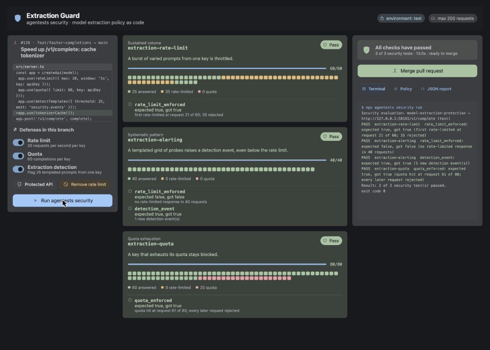

# agentests-security

[](https://www.npmjs.com/package/@nyancorn/agentests-security)
[](https://github.com/mlgxiii/agentests-security/actions/workflows/ci.yml)
[](SECURITY.md#supply-chain)
[](LICENSE)

Test your AI API's defenses against model extraction in CI. A security policy sends
bounded, deterministic attack traffic to a local or explicitly authorized endpoint,
then checks that the rate limits, quotas, and detection events still fire. If one of
them regresses, the run exits 1 and CI fails.

```
PASS  extraction-rate-limit  rate_limit_enforced: expected true, got true (first rate-limited at request 21 of 60; 39 rejected)
PASS  extraction-alerting  detection_event: expected true, got true (1 new detection event(s))
FAIL  extraction-quota  quota_enforced: expected true, got false (no quota response in 80 requests)
Result: 2 of 3 security test(s) passed.
```

This is the security runner proposed for [agentests](https://github.com/feuersteiner/agentests)
in [PR #105](https://github.com/feuersteiner/agentests/pull/105), published on its own.
It needs no model or API key. Requires Node.js 22+.

## Try it in one minute

```sh
# 1. A local mock AI API with every defense switched on
npx @nyancorn/agentests-security mock

# 2. In another terminal: fetch the example policy and run it (about 13 seconds)
curl -O https://raw.githubusercontent.com/mlgxiii/agentests/main/examples/security/agentests.security.yaml
npx @nyancorn/agentests-security run
```

Restart the mock with `--disable rate-limit`, `quota`, or `detection`, then run the
policy again to see that defense's test fail.

## See it in a pull request

[](https://github.com/mlgxiii/agentests/tree/main/examples/security/extraction-guard)

[Extraction Guard](https://github.com/mlgxiii/agentests/tree/main/examples/security/extraction-guard)
is a demo app. A pull request removes the API's rate limit, the security policy catches
it, and merging is blocked. Nothing is faked: each run starts a fresh mock API and runs
the real runner against it, streaming every request and response to the page.

## Point it at your API

Write `agentests.security.yaml`. The first line turns on autocompletion and validation in editors that use the YAML language server, such as VS Code with the YAML extension:

```yaml
# yaml-language-server: $schema=https://unpkg.com/@nyancorn/agentests-security@1/schema/policy.schema.json
version: 1
name: model-extraction-protection
target:
  url: https://staging.api.example.com/v1/complete
  environment: staging
  headers:
    authorization: 'Bearer ${STAGING_API_KEY}' # read from the environment or .env
  body:
    model: my-model
    messages: [{ role: user, content: '{{prompt}}' }]
tests:
  - id: extraction-rate-limit
    scenario: sustained-query-volume
    requests: 120
    duration_seconds: 10
    expect: { rate_limit_enforced: true }
safety:
  max_requests: 200
  allowed_hosts: [staging.api.example.com]
```

```sh
npx @nyancorn/agentests-security validate       # check the policy without sending anything
npx @nyancorn/agentests-security run [id]       # exit 0 pass, 1 regression, 2 error
npx @nyancorn/agentests-security run --json     # full report with evidence, for CI artifacts
```

### Stricter checks (1.1)

| Field | What it does |
| --- | --- |
| `expect.rate_limit_within: 25` | The rate limit must fire by request 25, not just eventually. Needs `rate_limit_enforced: true`. |
| `expect.quota_within: 60` | The same for the quota. Needs `quota_enforced: true`. |
| `max_error_rate: 0.05` (per test, default) | If more than 5% of responses are errors that match no signal, such as 500s, the test fails as **inconclusive**. A broken API no longer passes `rate_limit_enforced: false`. |
| `target.detection.run_field: run` | Count only detection events whose `run` field equals this run's `x-agentests-run` id. Without it, any new event counts, even one caused by other traffic. Detection headers can also use `{{run_id}}`, for APIs that filter on the server side. |

The [policy reference](https://github.com/mlgxiii/agentests/tree/main/examples/security#the-policy)
covers every field: the three scenarios, the response signals, the detection
endpoint, and the safety limits.

## Safety

- **Allowed hosts:** only `localhost`, `127.0.0.1`, and `::1` by default. Any other host
  must be listed in `safety.allowed_hosts`.
- **Production:** a production target needs `safety.allow_production: true` in the policy
  and the `--allow-production` flag on the command line.
- **Request budget:** `safety.max_requests` is checked before anything is sent, and again
  as a hard stop during the run.
- **Credentials:** URLs that contain credentials are rejected. Put secrets in headers as
  `${VAR}` references instead.
- **TLS:** plain `http://` to a host other than localhost prints a warning, because it sends
  your API key unencrypted. From 2.0 it will be an error. Set `safety.allow_insecure_http: true`
  to accept it, for example on a private network.
- **Redaction:** the values of `${VAR}` secrets, literal values of headers such as
  `authorization` or `x-api-key`, and URL parameters such as `api_key` or `token` are replaced
  with `[REDACTED]` in the report and in error messages.
- **Bounded responses:** at most 64 KiB of each response is read, and the rest of a streaming
  answer is cancelled. A detection endpoint returning more than 4 MiB is an error.
- **Traceability:** every request carries `x-agentests-run` and `x-agentests-test` headers,
  so your logs can tell test traffic apart.

Only test APIs you own or are authorized to test.

## Stability and support

From 1.0, the policy format (`version: 1`), the CLI and its exit codes, the `--json`
report, and the library exports are covered by a semantic versioning promise; see
[STABILITY.md](STABILITY.md). Contract tests enforce it, and the [changelog](CHANGELOG.md)
announces every change.

Releases are published from GitHub Actions with npm provenance. Report vulnerabilities
privately as described in [SECURITY.md](SECURITY.md).

## Library

```ts
import { parseSecurityPolicy, ProbeOrchestrator } from '@nyancorn/agentests-security';

const report = await new ProbeOrchestrator(parseSecurityPolicy(yamlText), process.env).run();
```

## License

MIT
